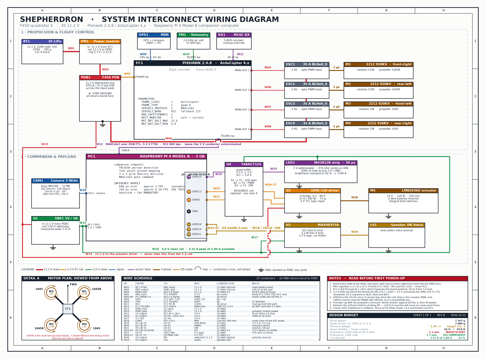

# 🔧 Shepherdron 하드웨어 스펙 검증서 (rev.B)

> **대상:** 연세대학교 창의제품설계 3분반 2조 하드웨어/비행제어 파트
> **검증일:** 2026-10-12 · **기준 기체:** F450 Quad X / 3S 11.1V / Pixhawk 2.4.8 / Raspberry Pi 4 2GB
> **이 문서의 목적:** rev.A 배선도(`shepherdron_master_blueprint.png`)에 포함된 **9건의 설계 오류를 교정**하고,
> 부품별 정격을 1차 출처로 재확인한 뒤 **질량·추력·전류·전원 예산을 수치로 검증**하는 것.



> 위 도면은 `generate_wiring_diagram.py`로 생성됩니다. 각 배선에는 **W## 번호**가 붙어 있고,
> 도면 하단 **WIRE SCHEDULE**에 출발점·도착점·전선 규격·주의사항이 1:1로 대응됩니다.
> **DETAIL A**는 모터 번호·회전 방향·프로펠러 종류를 위에서 본 배치로 보여줍니다.
> 같은 내용의 **텍스트판**은 [WIRING.md](WIRING.md)에 있습니다 (grep/diff 가능).

---

## 1. 우리가 만들려는 것 (기능 사양 확정)

| 항목 | 사양 | 근거 |
|---|---|---|
| **미션** | 군중 과밀집 구역을 자율 탐지 → 해당 지점 상공 호버링 → 오리가미 구조물 전개 + LED/음성으로 대피 유도 | `ROADMAP.md` Phase 1~4 |
| **인지** | Pi Camera 3 Wide(102° H) → YOLOv8n Person 검출 → Foot-point 매핑 → 3×3 그리드 밀집도 판정 | `vision/` 구현 완료 |
| **판단 임계치** | 셀당 5인 / 전체 15인 초과 시 `OVER-DENSITY ALERT` | `config.py` |
| **비행** | Pi → MAVLink2 → Pixhawk `GUIDED` 모드 `simple_goto`, 목표 고도 10 m 호버링 | `ROADMAP.md` Phase 2 |
| **전개** | LMB2036U 리니어 액추에이터로 Kresling 오리가미 전개 | `TASK_BOARD.md` HW-03 |
| **안전** | S.BUS 조종기 상시 수동 개입 + 텔레메트리 지상 관제 (이중 안전망) | rev.A 체크리스트 |

> **체공 요구사항이 사양서에 없습니다.** 아래 §4에서 현 구성의 체공시간은 **5.3분**으로 계산됩니다.
> 이륙·상승·탐색·호버링·귀환을 한 번에 수행하기에 부족하므로, 팀에서 **목표 체공시간을 먼저 확정**해 주세요.
> 그 값이 배터리 용량과 최대 페이로드 질량을 역으로 결정합니다.

---

## 2. rev.A에서 발견한 설계 오류 9건

| # | 위치 | 문제 | 교정 |
|:-:|---|---|---|
| 1 | 액추에이터 | **LMB2036U는 250 mm 스트로크 제품이 없습니다.** 판매 라인업은 6/12/24 V · 추력 30/60/120 N · 스트로크 **30~150 mm**(주문제작 포함)입니다. | **12 V / 120 N / 150 mm**로 확정. 250 mm가 구조상 필수라면 링크·레버 기구로 변위를 증폭하거나 액추에이터 2단 직렬이 필요합니다. |
| 2 | GPIO 18 | **핀 중복 할당.** rev.A는 GPIO 18을 액추에이터 PWM에 썼는데, MAX98357A I2S의 **BCLK가 GPIO 18로 고정**이고 `rpi_ws281x`의 PWM 구동도 GPIO 18을 씁니다. 세 기능이 같은 핀을 다툽니다. | 액추에이터는 **GPIO 13(PWM1)**, LED는 **GPIO 10(SPI0 MOSI)**, I2S는 GPIO 18/19/21 전용. |
| 3 | GPIO 12 | rev.A의 LED 핀 GPIO 12는 **GPIO 18과 같은 PWM0 채널**입니다. 둘을 동시에 하드웨어 PWM으로 못 씁니다. | LED를 **SPI0(GPIO 10)** 구동으로 변경. root 권한도 불필요해집니다. |
| 4 | 액추에이터 제어 | LMB2036U는 **적/흑 2선 극성 반전식**(리미트 스위치 내장)입니다. PWM 1핀만으로는 **수축이 불가능**합니다. | **PWM(GPIO 13) + DIR(GPIO 6)** 2선 제어로 변경. DMD-150 H-브리지가 극성 반전을 담당. |
| 5 | WS2812B | WS2812B의 입력 High 임계값은 **0.7 × VDD = 3.5 V**. Pi의 3.3 V GPIO는 **규격 미달**이라 첫 LED가 간헐적으로 오동작합니다. | **74AHCT125** 레벨 시프터(5 V 구동) 삽입. DIN에 470 Ω 직렬, 5 V–GND 간 1000 µF. |
| 6 | DMD-150 | 제조사(MotorBank)가 **5 V TTL 레벨** 입력을 명시합니다. Pi의 3.3 V를 직결하면 임계값 미달 위험. | 위 74AHCT125의 남는 게이트 2채널로 PWM·DIR을 **3.3 V → 5 V** 승압. |
| 7 | 누락 | rev.A 배선도에 **MAX98357A I2S 앰프 + 스피커**가 아예 없습니다(`TASK_BOARD` HW-05에는 존재). | rev.B에 전원·I2S 3선 포함해 반영. |
| 8 | 문서 모순 | `TASK_BOARD.md` HW-01은 **4S 14.8 V**, `HARDWARE_ARCHITECTURE.md`는 **3S 11.1 V**. | **3S 11.1 V로 통일.** 920KV 모터에 1045 프로펠러 조합은 4S에서 과회전·과전류이므로 3S가 맞습니다. (4S로 간다면 프로펠러를 8045/9045로 내려야 합니다.) |
| 9 | 연산 성능 | **Pi 4에서 YOLOv8n @640px는 약 3 FPS**(NCNN 기준)입니다. 군중 추적에 쓸 수 없습니다. | **320 px 입력 + NCNN export**로 약 8~10 FPS 확보. 히트싱크·팬 필수. 그래도 부족하면 Pi 5 또는 Hailo-8L AI Kit 검토. |

---

## 3. 확정 부품 스펙 (BOM)

### 3-1. 동력계

| 부품 | 확정 사양 | 수량 | 검증 메모 |
|---|---|:-:|---|
| 프레임 | F450 (PDB 일체형 암) | 1 | 282 g |
| 모터 | 2212 **920KV** BLDC | 4 | 11.1 V·1045 실측 642 g / 9.5 A (제조사 시험값) |
| 프로펠러 | **1045 × 2, 1045R × 2** | 4 | ⚠️ 정/역 프로펠러를 **반드시 쌍으로** 구매 |
| ESC | 35 A BLHeli_S (2–4S) | 4 | 모터 최대 ~13 A 대비 2.7배 여유 (과사양이나 안전측) |
| 배터리 | 3S 11.1 V **2200 mAh** 55C XT60 | 1 | 55C = 121 A 버스트, 전류는 충분. **용량이 부족**(§4) |
| 파워모듈 | 3DR 타입 홀센서형 | 1 | 5.3 V / **2.25 A** 출력 — FC·GPS·수신기 전용. **Pi 전원으로 쓰면 안 됨** |

### 3-2. 제어·통신계

| 부품 | 확정 사양 | 연결 | 검증 메모 |
|---|---|---|---|
| FC | Pixhawk 2.4.8, ArduCopter 4.x | — | 플래시 2 MB로 기능 축소 빌드만 탑재 가능 |
| GPS/나침반 | u-blox M8N | `GPS` + I2C | — |
| 텔레메트리 | 2.4 GHz 공중 모듈 | `TELEM1` @57600 | 지상 Mission Planner |
| 수신기 | Microzone MC6C S.BUS | `RC IN` | 상시 수동 개입 경로 |
| 컴패니언 | Raspberry Pi 4 Model B 2GB | `TELEM2` @921600 | **3.3 V 로직 FTDI** USB-TTL 케이블. 921600이 불안정하면 115200으로 하향 |
| 카메라 | Camera Module 3 Wide (IMX708) | CSI-2 | **102° 수평 / 120° 대각** FOV, 초점 5 cm~∞ |

### 3-3. 전원 분배 및 페이로드

| 부품 | 확정 사양 | 전원 | 검증 메모 |
|---|---|---|---|
| UBEC | 5 V / 5 A 스위칭 | PDB 11.1 V | 피크 3.15 A 사용 (63%) |
| 모터 드라이버 | **DMD-150** | PDB 11.1 V 직결 | 6.5–40 V / 15 A / 360 W / 53 g, **5 V TTL 입력** |
| 액추에이터 | **LMB2036U 12 V / 120 N / 150 mm** | DMD-150 출력 | 11.1 V 구동 시 정격 대비 속도 약 8% 감소(허용) |
| LED | WS2812B **30 LED** | UBEC 5 V | 74AHCT125 경유. **밝기 50% 상한 필수** (100% 백색 시 1.8 A) |
| 오디오 | MAX98357A + 3 W 4 Ω 스피커 | UBEC 5 V | I2S GPIO 18/19/21 고정 |
| 레벨 시프터 | 74AHCT125 (쿼드) | UBEC 5 V | 4채널 중 3채널 사용 (LED DIN, DMD PWM, DMD DIR) |

---

## 4. 설계 예산 검증

### 4-1. 질량 예산 — **AUW 1,567 g**

| 구성 | 질량 | 구성 | 질량 |
|---|---:|---|---:|
| F450 프레임 | 282 g | 3S 2200 mAh | 185 g |
| 모터 ×4 | 212 g | Pi 4 + Cam3 + UBEC | 86 g |
| ESC ×4 | 112 g | DMD-150 + LMB2036U | 133 g |
| 프로펠러 ×4 | 52 g | 오리가미 구조물 | 150 g |
| Pixhawk + GPS + 무선 | 175 g | LED + 앰프 + 스피커 | 60 g |
| | | 배선·체결류 | 120 g |
| | | **합계** | **1,567 g** |

### 4-2. 추력 마진 — **T/W 1.79 : 1** ⚠️

```
정지추력  = 4 × 700 g  = 2,800 g      (1045 @ 11.1V, 보수적 추정)
추력중량비 = 2,800 / 1,567 = 1.79 : 1
호버 스로틀 = 56 %
```

업계 권장치는 **2.0 : 1**, 최저 허용선이 1.5 : 1입니다. 현 구성은 **비행은 가능하나 여유가 얇습니다.**
→ **오리가미 구조물 질량을 150 g 이하로 묶어주세요.** 이를 넘기면 T/W가 1.6 아래로 떨어지고
바람 속에서 자세 제어 권한(attitude authority)이 급격히 나빠집니다.

### 4-3. 체공 시간 — **현 구성 5.3분** ❌

호버 전류 = 모터 17.8 A + 전장 2.0 A = **19.8 A**

| 배터리 | AUW | T/W | 호버 전류 | 체공(DoD 80%) | 평가 |
|---|---:|---:|---:|---:|---|
| 2200 mAh (현 사양) | 1,567 g | 1.79 | 19.8 A | **5.3 분** | ❌ 임무 수행 불가 |
| **3300 mAh (권장)** | 1,637 g | 1.71 | 20.6 A | **7.7 분** | ✅ 추력·체공 균형점 |
| 5000 mAh | 1,762 g | 1.59 | 22.0 A | 10.9 분 | ⚠️ 추력 마진 부족 |

> **권장:** 3S **3300 mAh**로 교체. 2200 mAh는 예비/벤치 테스트용으로 유지.

### 4-4. 5 V UBEC 전원 예산 — **3.15 A / 5.0 A (63%)** ✅

| 부하 | 전류 |
|---|---:|
| Pi 4 + Cam3 (YOLO 부하 시) | 1.50 A |
| WS2812B 30 LED @ 밝기 50% | 0.90 A |
| MAX98357A 피크 | 0.70 A |
| 74AHCT125 외 | 0.05 A |
| **합계 피크** | **3.15 A** |

⚠️ LED를 60개로 늘리거나 밝기 상한을 풀면 **5 A를 초과해 Pi가 리부팅**됩니다. 코드에서 상한을 강제하세요.

---

## 5. 결선표 (조립 가이드)

### 5-1. Pixhawk 2.4.8

| 포트 | 연결 대상 | 케이블 | 비고 |
|---|---|---|---|
| `POWER` | 파워모듈 | 6핀 몰렉스 | 5.3 V 공급 + 전압/전류 센싱 |
| `MAIN OUT 1` | ESC 1 → **M1 전방우측 CCW / 1045R** | 서보 3핀 | ArduCopter Quad X 배치 |
| `MAIN OUT 2` | ESC 2 → **M2 후방좌측 CCW / 1045R** | 서보 3핀 | |
| `MAIN OUT 3` | ESC 3 → **M3 전방좌측 CW / 1045** | 서보 3핀 | |
| `MAIN OUT 4` | ESC 4 → **M4 후방우측 CW / 1045** | 서보 3핀 | |
| `GPS` | M8N GPS/나침반 | 6핀 + 4핀 I2C | |
| `TELEM 1` | 텔레메트리 공중 모듈 | 6핀 | 57600 bps |
| `TELEM 2` | Pi 4 USB (USB-TTL) | **3.3 V FTDI** | 921600 bps. **5 V 선은 연결 금지**(역급전 방지) |
| `RC IN` | MC6C S.BUS 수신기 | 서보 3핀 | 비상 수동 조종 |

**ArduPilot 파라미터**
```
FRAME_CLASS      = 1      # Multicopter
FRAME_TYPE       = 1      # Quad X
SERIAL2_PROTOCOL = 2      # MAVLink2
SERIAL2_BAUD     = 921    # 불안정 시 115
BRD_SAFETYENABLE = 1      # 안전 스위치 활성
BATT_MONITOR     = 4      # 파워모듈 전압+전류
MOT_BAT_VOLT_MAX = 12.6   # 3S
MOT_BAT_VOLT_MIN = 9.9    # 3S
```

### 5-2. Raspberry Pi 4 — **핀맵 확정본**

| 기능 | BCM | 물리핀 | 연결 대상 | 비고 |
|---|:-:|:-:|---|---|
| 5 V 전원 | — | 2 | UBEC 5 V | 인라인 3 A 퓨즈 권장 (GPIO 급전은 Pi 내부 폴리퓨즈를 우회) |
| GND | — | 6, 9, 14… | 공통 접지 | PDB 스타 그라운드 |
| 카메라 | — | CSI | Camera Module 3 Wide | 200 mm FPC |
| MAVLink | — | USB-A | Pixhawk `TELEM 2` | 3.3 V FTDI |
| **액추에이터 PWM** | **GPIO 13** | 33 | 74AHCT125 → DMD-150 PWM | PWM1 채널 (I2S와 비충돌) |
| **액추에이터 DIR** | **GPIO 6** | 31 | 74AHCT125 → DMD-150 DIR | 전개/수축 방향 |
| **LED 데이터** | **GPIO 10** | 19 | 74AHCT125 → WS2812B DIN | SPI0 MOSI 구동, root 불필요 |
| I2S BCLK | GPIO 18 | 12 | MAX98357A BCLK | I2S 하드웨어 고정 |
| I2S LRCLK | GPIO 19 | 35 | MAX98357A LRC | 〃 |
| I2S DIN | GPIO 21 | 40 | MAX98357A DIN | 〃 |

### 5-3. 전력 분배

| 라인 | 시작 | 끝 | 전압 |
|---|---|---|---|
| 메인 | 3S LiPo (XT60) | 파워모듈 → F450 PDB | 11.1 V |
| 모터 | PDB | ESC ×4 → 모터 ×4 | 11.1 V |
| 액추에이터 | PDB | DMD-150 VCC | 11.1 V (**5 V 레일에서 절대 금지**) |
| 컴패니언 | PDB | 5 V/5 A UBEC → Pi·LED·앰프·시프터 | 5.0 V |
| 센싱 | 파워모듈 | Pixhawk `POWER` | 5.3 V |

---

## 6. 조립 전 필수 체크리스트

- [ ] **모든 GND를 PDB 한 점(star ground)에 모을 것.** Pi·DMD-150·Pixhawk·UBEC 접지가 분리되면 PWM 신호가 뜹니다.
- [ ] PDB 입력단에 **470 µF / 25 V 저ESR 콘덴서** 장착 (ESC 스위칭 서지 흡수).
- [ ] UBEC 5 V 레일에 **1000 µF** 벌크 콘덴서 (LED 돌입전류 흡수).
- [ ] WS2812B **DIN에 470 Ω 직렬저항**.
- [ ] USB-TTL 케이블의 **5 V 선은 절연 처리**.
- [ ] 프로펠러 **정/역 방향 확인** — 1045R은 M1·M2(CCW), 1045는 M3·M4(CW).
- [ ] 첫 시동은 **반드시 프로펠러를 제거**하고 모터 회전 방향만 확인.
- [ ] 파워모듈 5.3 V 레일에 Pi를 물리지 말 것 (2.25 A 한계).
- [ ] 액추에이터 전개 시험은 **기체를 고정한 상태**에서 (120 N 반력이 기체를 밀어냄).
- [ ] Pi에 **히트싱크 + 팬** 장착 후 YOLO 구동 (무냉각 시 쓰로틀링).

---

## 7. 남은 미확정 항목

1. **목표 체공시간** — 팀 확정 필요. 배터리 용량과 페이로드 상한을 결정합니다.
2. **오리가미 구조물 실측 질량** — 150 g 가정치. 실측 후 §4-2 재계산 필요.
3. **전개 필요 추력** — 120 N 가정. Kresling 구조 시작품으로 실측 권장.
4. **LMB2036U 250 mm 대안** — 링크 증폭 / 2단 직렬 / 타 시리즈 중 택일.
5. **DMD-150 단자 배열** — 제조사 데이터시트 원본 미확보. MotorBank 기술상담으로 PWM·DIR 단자명 확인 필요.

---

### 출처

- [MotorBank — 양방향 DC모터 컨트롤러 DMD-150 (6.5~40V / 15A / 360W / 53g / 5V TTL)](https://www.motorbank.kr/goods/goods_view.php?goodsNo=1000009128)
- [MotorBank — LMB2036U 리니어 액추에이터 (DC 6/12/24V, 30·60·120N, 스트로크 30~150mm)](https://www.motorbank.kr/goods/goods_view.php?goodsNo=1000034633)
- [Funduinoshop — 2212 920KV 벤치 데이터 (11.1V / 1045 / 9.5A / 642g / 105W)](https://funduinoshop.com/en/electronic-modules/electric-motors-and-accessories/brushless-motors/2212-brushless-motor-920kv-cw-sliver)
- [PiShop — Raspberry Pi Camera Module 3 Wide (IMX708, 102° H / 120° D)](https://www.pishop.us/product/raspberry-pi-camera-module-3-wide/)
- [Q-engineering — YOLOv8 NCNN 벤치마크 (nano @640: RPi4 3.1 FPS)](https://awesome.ecosyste.ms/projects/github.com%2Fqengineering%2Fyolov8-ncnn-raspberry-pi-4)
- [Adafruit / 커뮤니티 — WS2812B VIH = 0.7×VDD, 74AHCT125 레벨 시프트 권장](https://forum.arduino.cc/t/level-shifter-for-ws2812b-led/1040966)
