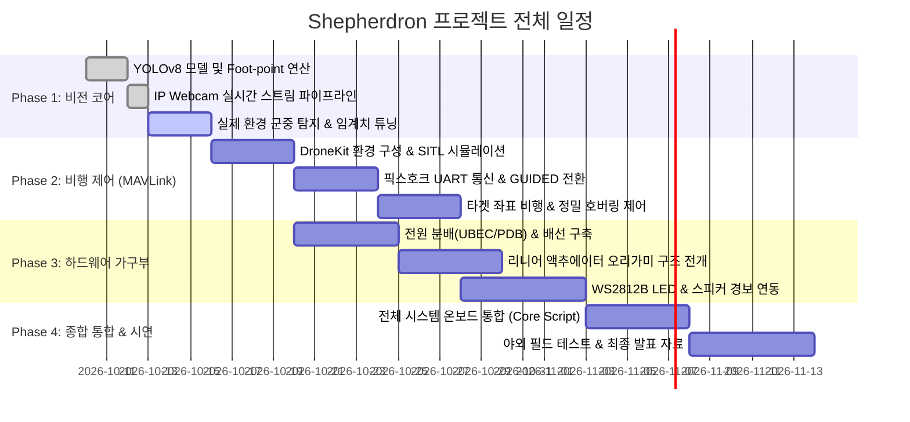

# 🗺️ Shepherdron 프로젝트 개발 로드맵 (Roadmap)

본 로드맵은 **Shepherdron(하늘의 안내자)** 프로젝트의 주차별 개발 단계와 마일스톤 달성 목표를 정의합니다.

---

## 📅 단계별 마일스톤 (Milestones)

---

### 📍 Phase 1: 비전 인식 및 인구 밀집도 프로토타입 (현재 단계)
- **목표:** 스마트폰 카메라 스트림을 통해 실시간 군중 카운팅, 히트맵 오버레이 및 과밀집 판정 검증
- **주요 산출물:**
  - `vision/detector.py`: YOLOv8n + Foot-point 연산
  - `vision/density_analyzer.py`: 그리드별 밀집도 & 타겟 좌표 산출
  - `test_module.py`: 모듈 단위/통합 테스트
- **완료 기준:** 스마트폰 카메라로 사람 이동 시 과밀집 경보가 정확하게 발생할 것.

---

### 📍 Phase 2: 자율비행 제어 및 MAVLink 통신
- **목표:** 픽스호크(KOA FC)와 라즈베리파이 간 UART 통신을 확립하고, 과밀집 발생 시 자율 이동 명령 전송
- **주요 산출물:**
  - `flight/mavlink_controller.py`: MAVLink 연결, GUIDED 모드 전환, `simple_goto` 비행
  - SITL 기반 가상 비행 시뮬레이션 환경
- **완료 기준:** 시뮬레이터 또는 벤치 테스트에서 타겟 GPS 좌표로 드론이 10m 고도로 이동 후 정지 호버링할 것.

---

### 📍 Phase 3: 가구부 및 주야간 안내 시스템
- **목표:** 호버링 도달 신호 수신 시 리니어 액추에이터 전개, 네오픽셀 LED 발광 및 스피커 음성 송출
- **주요 산출물:**
  - `hardware/actuator.py`: GPIO 18 PWM 제어 (듀티비 80% 전개 ➔ 0% 고정)
  - `hardware/indicators.py`: WS2812B 방향 유도 패턴 및 I2S 오디오 경보
- **완료 기준:** 액추에이터가 250mm 스트로크를 안전하게 전개하고 LED/음성이 정상 작동할 것.

---

### 📍 Phase 4: 종합 시스템 통합 & 현장 시연
- **목표:** 라즈베리파이 4 companion computer에 전체 코드를 적재하고 야외 실증 비행 시연 수행
- **주요 산출물:**
  - `shepherdron_core.py`: 비전 + 비행 + 하드웨어 통합 단일 루프
  - 시연 영상, 최종 보고서 및 발표 슬라이드
