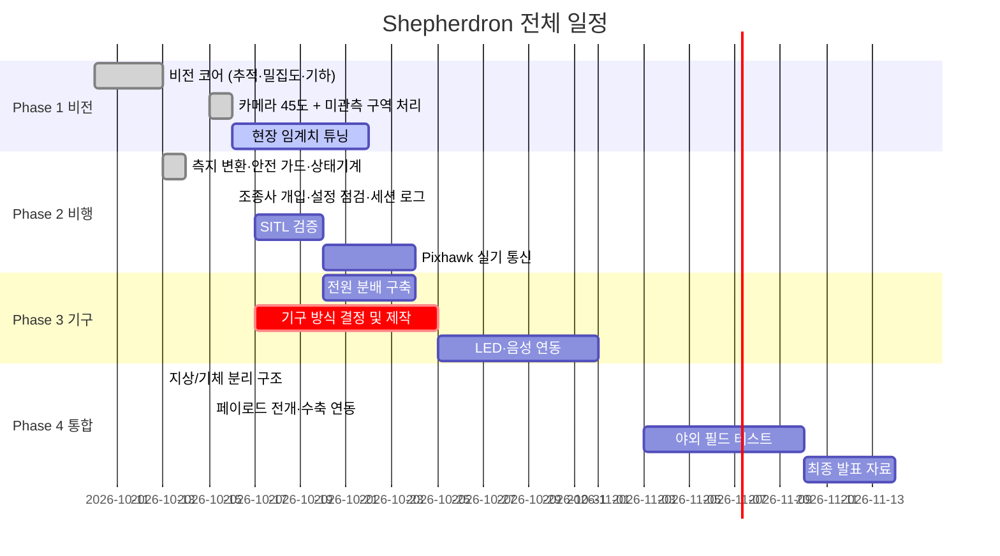

Shepherdron 개발 로드맵

최근 갱신 : 2026-10-16 · 시연 장소 실내 확정, 4S 구성 확정

---

현재 상태

| Phase | 내용 | 상태 |
|---|---|---|
| 1 | 비전 인식 및 밀집도 판정 | 코어 완료 · 현장 검증 남음 |
| 2 | 자율비행 제어 (MAVLink) | 코어 완료 · SITL/실기 검증 남음 |
| 3 | 기구부 및 안내 시스템 | 소프트웨어 준비 완료 · **기구 방식 미결정** |
| 4 | 통합 및 시연 | 통합 완료 · 현장 시연 남음 |

 **시연 장소가 실내 강당으로 확정됐습니다.** GPS 가 없어 옵티컬 플로우 센서가
추가로 필요하고, 천장 4.22 m 라 고도·구조물 길이 전제가 바뀝니다. [INDOOR.md](INDOOR.md)

**소프트웨어는 대부분 올라왔고, 남은 일은 거의 전부 실기 검증입니다.**
테스트 268건이 하드웨어 없이 돌아갑니다.

---

일정

---

Phase 1 : 비전 인식

목표 : 군중 영상에서 원근 보정된 밀집도(persons/m²)를 산출하고 과밀집 지점의
기체 기준 좌표를 내보낸다.

완료
- YOLOv8n + ByteTrack 인물 검출·추적 (프레임 간 ID 유지)
- 지상 평면 호모그래피 기반 persons/m² 판정
- 경보 히스테리시스 (단발 오검출이 비행 명령이 되지 않도록)
- 카메라 45° 기울임 : 수직 하향은 사람이 6.5 px 라 검출 불가
- 검출 범위 밖 구역을 UNKNOWN 처리 (보이지 않는 곳을 "안전"이라 하지 않음)

남은 것 : [#1](https://github.com/kennykimtang/shepherdron/issues/1) 현장 튜닝,
[#2](https://github.com/kennykimtang/shepherdron/issues/2) CSI 카메라,
[#3](https://github.com/kennykimtang/shepherdron/issues/3) Pi 성능 실측

산출물 : [VISION.md](VISION.md)

---

Phase 2 : 자율비행 제어

목표 : 비전이 낸 기체 기준 오프셋을 GPS 좌표로 바꿔 GUIDED 유도 비행하고
안전하게 복귀한다.

완료
- 기체 기준 오프셋 ↔ 위경도 변환, 반경 제한 (잘못된 타겟이 기체를 날려보내지 않도록)
- Pixhawk 연결·모드 전환 검증·arm/takeoff/goto 안전 가드
- 임무 상태기계 (IDLE → NAVIGATING → HOVERING → RETRACTING → RETURNING)
- 조종사 수동 전환 시 STANDBY : 조종권을 되찾아가지 않음
- 설정 정합성 점검, 세션 로그

남은 것 : [#4](https://github.com/kennykimtang/shepherdron/issues/4) SITL 검증,
[#5](https://github.com/kennykimtang/shepherdron/issues/5) TELEM2 실기 통신,
정밀 호버링 정확도 측정

산출물 : [FLIGHT.md](FLIGHT.md), [OPERATIONS.md](OPERATIONS.md)

---

Phase 3 : 기구부 및 안내 시스템

목표 : 과밀집 지점 도달 시 600 mm 구조물을 전개하고 LED·음성으로 대피를 유도한다.

완료
- 기구 방식과 무관한 페이로드 추상화 (deploy / retract / is_stowed)
- 전개 상태로 복귀하지 않도록 RETRACTING 상태 : 접힘 확인 전 RTL 금지

 **이 Phase 의 크리티컬 패스 : 기구 방식 결정**
([#9](https://github.com/kennykimtang/shepherdron/issues/9))

600 mm 확장은 액추에이터 스트로크로 풀 수 없습니다. 단단 600 mm 액추에이터는
1,400 g 로 구조물 예산(150 g)의 10배입니다. 윈치 방식이면 80 g 안에 들어옵니다.
결정 전까지 실제 드라이버를 쓸 수 없으므로 **가장 먼저 정해야 합니다.**

남은 것 : [#7](https://github.com/kennykimtang/shepherdron/issues/7) 전원 분배,
[#8](https://github.com/kennykimtang/shepherdron/issues/8) 액추에이터 제어,
[#9](https://github.com/kennykimtang/shepherdron/issues/9) 기구 제작,
[#10](https://github.com/kennykimtang/shepherdron/issues/10) LED,
[#11](https://github.com/kennykimtang/shepherdron/issues/11) 음성,
[#12](https://github.com/kennykimtang/shepherdron/issues/12) 배터리

산출물 : [PAYLOAD.md](PAYLOAD.md), [WIRING.md](WIRING.md)

---

Phase 4 : 통합 및 시연

목표 : 전체를 묶어 야외에서 실증한다.

완료
- 지상/기체 역할 분리 : 노트북이 YOLO, 기체가 판단·구동
- 링크는 관측만 나르고 비행 명령은 나르지 않음
- 링크 끊김 시 기체 단독으로 안전 복귀

남은 것 : [#13](https://github.com/kennykimtang/shepherdron/issues/13) 페이로드 연동·systemd,
[#14](https://github.com/kennykimtang/shepherdron/issues/14) 발표 자료

산출물 : [ARCHITECTURE.md](ARCHITECTURE.md)

---

팀 결정이 필요한 사항

| # | 내용 | 막고 있는 것 |
|---|---|---|
| 0 | **옵티컬 플로우 센서 구매** : 없으면 실내에서 자율비행 불가 | Phase 2 실내 검증 |
| 1 | **기구 방식 + 실내용 길이** : 600 mm 는 천장 4.22 m 에서 사람 머리에 닿음 | Phase 3 전체 |
| 2 | **목표 체공시간** : 2200 mAh 기준 5.3분. 배터리 용량과 페이로드 상한을 역으로 결정 | 배터리 구매 |
| 3 | **전개 방향** : 아래면 중력이 펴주고, 옆·위면 스프링 필요 | 기구 설계 |
| 4 | **구조물 질량 150 g 상한** : 초과 시 T/W 1.6 아래로 떨어짐 | 기구 설계 |
